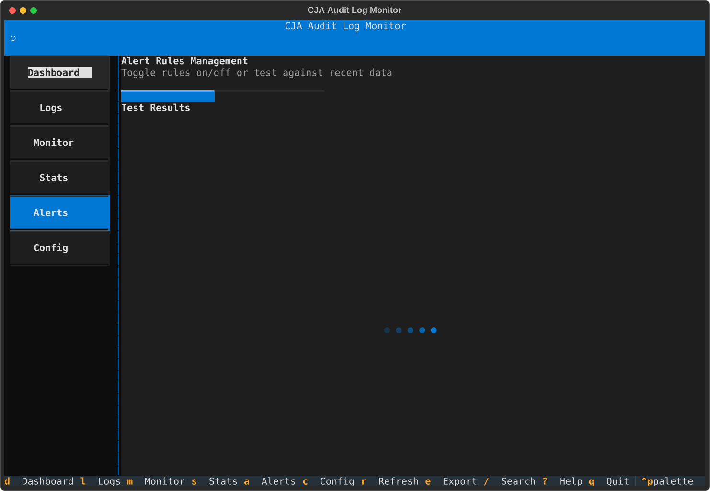

# Adobe Customer Journey Analytics Audit Log Monitor

A powerful TUI (Text User Interface) application for monitoring and analyzing Adobe Customer Journey Analytics (CJA) audit logs in real-time.

## Features

- **Interactive Navigation**: Keyboard-driven interface for fast navigation
- **Real-Time Updates**: Monitor audit logs as they happen with configurable polling
- **Smart Filtering**: Search by user, action type, component, and text
- **Visual Analytics**: Bar charts for action distribution and activity patterns
- **Alert Detection**: Configurable rules for bulk deletes, exports, and suspicious patterns
- **Export Options**: Save filtered logs to JSON, CSV, or TSV
- **Connection Status**: Live API connection monitoring

## Quick Start

> Prefix commands with `uv run` (e.g. `uv run cja-audit`), or activate the venv first (`source .venv/bin/activate`) and run them directly.

```bash
# 1. Clone
git clone https://github.com/brian-a-au/cja_audit_log_monitor
cd cja_audit_log_monitor

# 2. Install uv (skip if you already have it)
curl -LsSf https://astral.sh/uv/install.sh | sh

# 3. Sync the project (creates .venv/ and installs all dependencies)
uv sync --all-extras

# 4. Configure credentials — see docs/configuration.md for the full walkthrough
cp .env.example .env
# Edit .env with your Adobe ORG_ID, CLIENT_ID, SECRET, SCOPES

# 5. Launch the TUI
uv run cja-audit
```

That's it! The interactive TUI will launch with a dashboard showing your audit log activity.

## The TUI Experience

The application provides a full-featured terminal interface built with [Textual](https://textual.textualize.io/). Navigate between screens using keyboard shortcuts for a seamless experience.

### [Dashboard](docs/screens/dashboard.md) (Press `d`)

Your home base showing at-a-glance metrics including total entries, date range, action distribution charts, top active users, and recent anomalies. [Read more →](docs/screens/dashboard.md)


### [Log Browser](docs/screens/log-browser.md) (Press `l`)

Browse, search, and filter audit logs with a powerful data table. Filter by user, action type, component, or search text. Press `Enter` on any row to view full entry details. [Read more →](docs/screens/log-browser.md)


### [Real-Time Monitor](docs/screens/monitor.md) (Press `m`)

Watch audit events stream in as they happen. Configure polling intervals, see live statistics, and get instant alert notifications for suspicious activity. [Read more →](docs/screens/monitor.md)


### [Statistics](docs/screens/statistics.md) (Press `s`)

Detailed analytics with visual charts showing action distribution, hourly/daily activity patterns, and user rankings. [Read more →](docs/screens/statistics.md)


### [Alert Rules](docs/screens/alerts.md) (Press `a`)

Configure and manage suspicious activity detection rules. Enable/disable rules, adjust thresholds, and test against recent data. [Read more →](docs/screens/alerts.md)



### [Settings](docs/screens/settings.md) (Press `c`)

View connection status, API configuration, and application settings. [Read more →](docs/screens/settings.md)


## Keyboard Shortcuts

| Key | Action |
|-----|--------|
| `d` | Go to Dashboard |
| `l` | Go to Log Browser |
| `m` | Go to Monitor |
| `s` | Go to Statistics |
| `a` | Go to Alerts |
| `c` | Go to Config/Settings |
| `/` | Focus search/filter bar |
| `r` | Refresh current view |
| `e` | Open export dialog |
| `Enter` | View entry details (in Log Browser) |
| `?` | Show help overlay |
| `Esc` | Close modal/dialog |
| `q` | Quit application |

## Documentation

Setup, scripting, and reference material live under [`docs/`](docs/):

| Topic | Page |
|---|---|
| Configure Adobe OAuth credentials and verify | [docs/configuration.md](docs/configuration.md) |
| OAuth errors, setup checklist, security notes | [docs/troubleshooting.md](docs/troubleshooting.md) |
| Full CLI command reference (`cja-audit cli ...`) | [docs/cli.md](docs/cli.md) |
| Alert-rule schema and tuning | [docs/alert-rules.md](docs/alert-rules.md) |
| Action types, component types, upstream API | [docs/reference.md](docs/reference.md) |
| Tests, lint, project layout | [docs/development.md](docs/development.md) |
| Per-screen TUI guides | [docs/screens/](docs/screens/) |

## License

MIT
