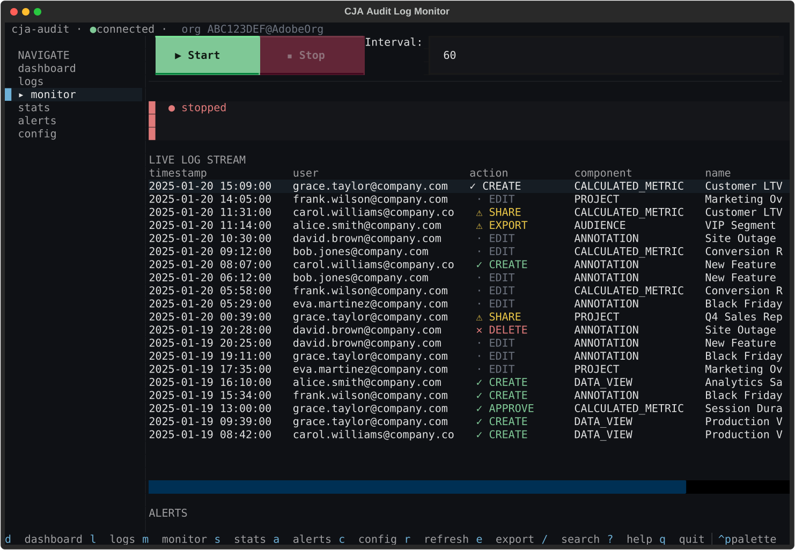
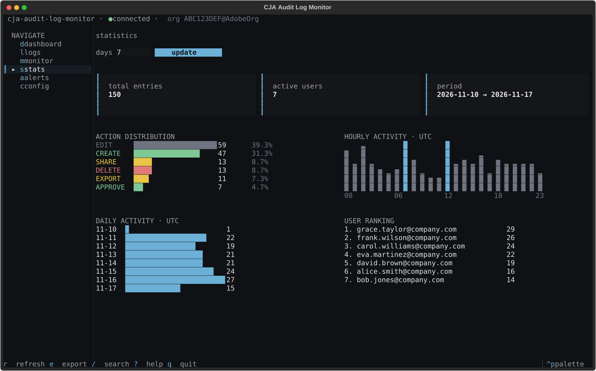
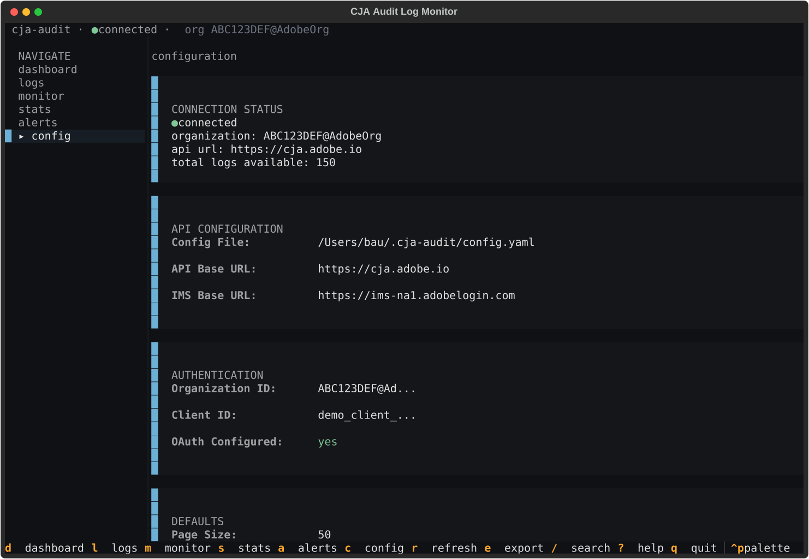

# CJA Audit Log Monitor

[](https://github.com/brian-a-au/cja-audit-log-monitor/actions/workflows/ci.yml)
[](https://pypi.org/project/cja-audit-log-monitor/)
[](https://pypi.org/project/cja-audit-log-monitor/)
[](https://github.com/brian-a-au/cja-audit-log-monitor/blob/main/LICENSE)

A terminal app for monitoring and analyzing Adobe Customer Journey Analytics (CJA) audit logs. You can browse and filter the logs, watch new events arrive, see charts of activity, and get alerts about suspicious patterns. A CLI is included for scripts and automation.


> This is an unofficial, community project. It is not affiliated with, endorsed by, or supported by Adobe. Adobe and Customer Journey Analytics are trademarks of Adobe Inc.

## Features

- **Keyboard navigation.** Each view has a single key, and `?` shows them all.
- **Real-time monitor.** New audit events appear as they happen, at a polling interval you choose.
- **Filtering.** You can search by user, action type, component type, and text.
- **Charts.** You can see action counts, activity by hour, and activity by day.
- **Alerts and anomalies.** Rules detect bulk deletes, exports, and activity outside business hours. You can send alerts to Slack or to a webhook.
- **Export.** You can save filtered logs as JSON, CSV, or TSV, either the page you see or every matching entry.

## Install

You need Python 3.11 or newer. Install the tool with [uv](https://docs.astral.sh/uv/) or [pipx](https://pipx.pypa.io/):

```bash
uv tool install cja-audit-log-monitor
# or
pipx install cja-audit-log-monitor
```

## Set up credentials

The tool uses an Adobe OAuth Server-to-Server credential from the [Adobe Developer Console](https://developer.adobe.com/console). See [docs/configuration.md](https://github.com/brian-a-au/cja-audit-log-monitor/blob/main/docs/configuration.md) for the full steps.

Set these environment variables, or put them in a `.env` file in the folder where you run the tool:

```bash
ORG_ID=YOUR_ORG_ID@AdobeOrg
CLIENT_ID=your_client_id
SECRET=your_client_secret
```

Then check that the connection works:

```bash
cja-audit-log-monitor cli verify
```

## Run it

```bash
# Open the TUI
cja-audit-log-monitor

# Or use the CLI, e.g. watch for anomalies and send them to Slack.
# Delivery is off by default. Set notify_on_anomalies: true to turn it on.
cja-audit-log-monitor cli anomalies --watch
```

## Run from source

```bash
git clone https://github.com/brian-a-au/cja-audit-log-monitor
cd cja-audit-log-monitor
uv sync --all-extras
cp .env.example .env   # then add your credentials
uv run cja-audit-log-monitor
```

## The TUI Experience

The application provides a full-featured terminal interface built with [Textual](https://textual.textualize.io/). Navigate between screens using keyboard shortcuts for a seamless experience.

### [Dashboard](https://github.com/brian-a-au/cja-audit-log-monitor/blob/main/docs/screens/dashboard.md) (Press `d`)

Your home base showing at-a-glance metrics including total entries, date range, action distribution charts, top active users, and recent anomalies. [Read more →](https://github.com/brian-a-au/cja-audit-log-monitor/blob/main/docs/screens/dashboard.md)

### [Log Browser](https://github.com/brian-a-au/cja-audit-log-monitor/blob/main/docs/screens/log-browser.md) (Press `l`)

Browse, search, and filter audit logs with a powerful data table. Filter by user, action type, component, or search text. Press `Enter` on any row to view full entry details. [Read more →](https://github.com/brian-a-au/cja-audit-log-monitor/blob/main/docs/screens/log-browser.md)


### [Real-Time Monitor](https://github.com/brian-a-au/cja-audit-log-monitor/blob/main/docs/screens/monitor.md) (Press `m`)

Watch audit events stream in as they happen. Configure polling intervals, see live statistics, and get instant alert notifications for suspicious activity. [Read more →](https://github.com/brian-a-au/cja-audit-log-monitor/blob/main/docs/screens/monitor.md)



### [Statistics](https://github.com/brian-a-au/cja-audit-log-monitor/blob/main/docs/screens/statistics.md) (Press `s`)

Detailed analytics with visual charts showing action distribution, hourly/daily activity patterns, and user rankings. [Read more →](https://github.com/brian-a-au/cja-audit-log-monitor/blob/main/docs/screens/statistics.md)



### [Alert Rules](https://github.com/brian-a-au/cja-audit-log-monitor/blob/main/docs/screens/alerts.md) (Press `a`)

Configure and manage suspicious activity detection rules. Enable/disable rules, adjust thresholds, and test against recent data. [Read more →](https://github.com/brian-a-au/cja-audit-log-monitor/blob/main/docs/screens/alerts.md)


### [Settings](https://github.com/brian-a-au/cja-audit-log-monitor/blob/main/docs/screens/settings.md) (Press `c`)

View connection status, API configuration, and application settings. [Read more →](https://github.com/brian-a-au/cja-audit-log-monitor/blob/main/docs/screens/settings.md)



## Keyboard Shortcuts

| Key | Action |
|-----|--------|
| `d` | Go to Dashboard |
| `l` | Go to Log Browser |
| `m` | Go to Monitor |
| `s` | Go to Statistics |
| `a` | Go to Alerts |
| `c` | Go to Config/Settings |
| `/` | Focus search/filter bar |
| `r` | Refresh current view |
| `e` | Open export dialog |
| `n` / `p` | Next or previous page (in Log Browser) |
| `Enter` | View entry details (in Log Browser) |
| `space` | Start or stop monitoring (in Monitor) |
| `?` | Show help overlay |
| `Esc` | Close modal/dialog |
| `q` | Quit application |

## Documentation

Setup, scripting, and reference material live under [`docs/`](https://github.com/brian-a-au/cja-audit-log-monitor/blob/main/docs/):

| Topic | Page |
|---|---|
| Configure Adobe OAuth credentials and verify | [docs/configuration.md](https://github.com/brian-a-au/cja-audit-log-monitor/blob/main/docs/configuration.md) |
| OAuth errors, setup checklist, security notes | [docs/troubleshooting.md](https://github.com/brian-a-au/cja-audit-log-monitor/blob/main/docs/troubleshooting.md) |
| Full CLI command reference (`cja-audit-log-monitor cli ...`) | [docs/cli.md](https://github.com/brian-a-au/cja-audit-log-monitor/blob/main/docs/cli.md) |
| Alert-rule schema and tuning | [docs/alert-rules.md](https://github.com/brian-a-au/cja-audit-log-monitor/blob/main/docs/alert-rules.md) |
| Action types, component types, upstream API | [docs/reference.md](https://github.com/brian-a-au/cja-audit-log-monitor/blob/main/docs/reference.md) |
| Tests, lint, project layout | [docs/development.md](https://github.com/brian-a-au/cja-audit-log-monitor/blob/main/docs/development.md) |
| Per-screen TUI guides | [docs/screens/](https://github.com/brian-a-au/cja-audit-log-monitor/blob/main/docs/screens/) |

## Contributing

Bug reports and pull requests are welcome. See [CONTRIBUTING.md](https://github.com/brian-a-au/cja-audit-log-monitor/blob/main/CONTRIBUTING.md). To report a security problem, see [SECURITY.md](https://github.com/brian-a-au/cja-audit-log-monitor/blob/main/SECURITY.md).

## License

MIT. See [LICENSE](https://github.com/brian-a-au/cja-audit-log-monitor/blob/main/LICENSE).
