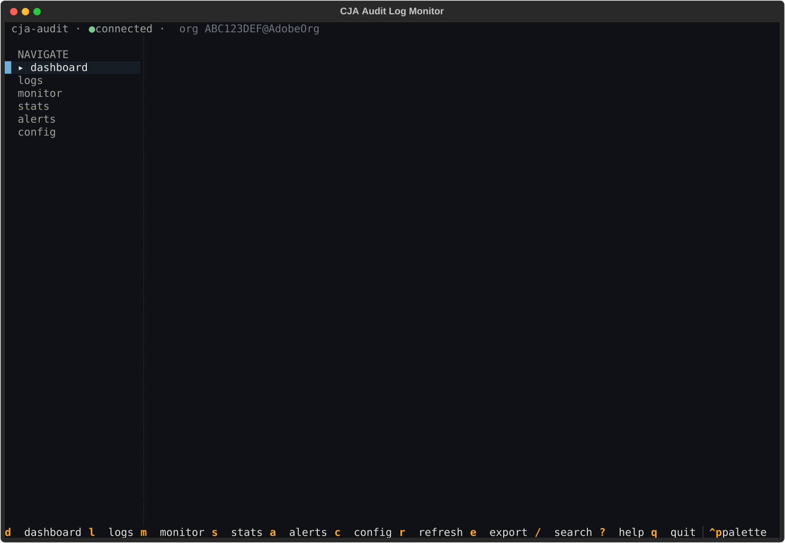
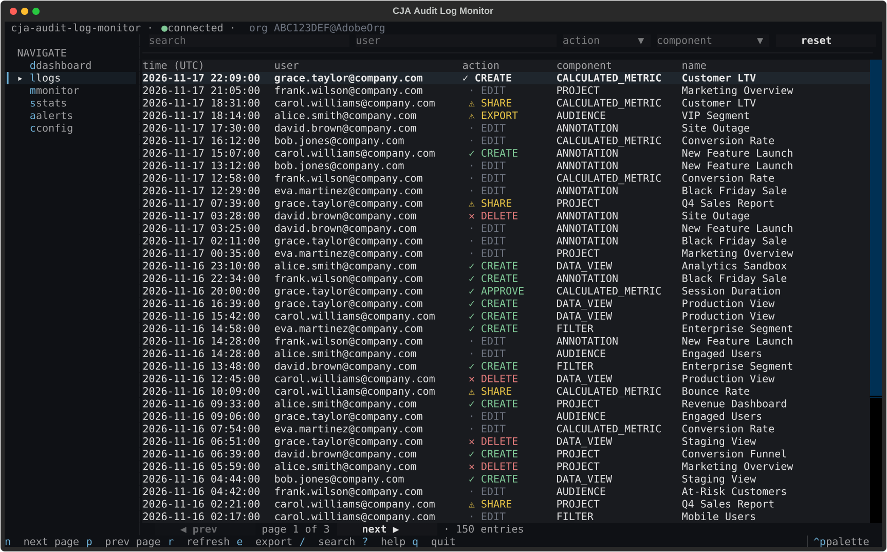

# Adobe Customer Journey Analytics Audit Log Monitor

A powerful TUI (Text User Interface) application for monitoring and analyzing Adobe Customer Journey Analytics (CJA) audit logs in real-time.

## Quick Start

```bash
# Install
uv pip install -e .

# Configure credentials
cp .env.example .env
# Edit .env with your Adobe credentials

# Launch the TUI
cja-audit
```

That's it! The interactive TUI will launch with a dashboard showing your audit log activity.

## The TUI Experience

The application provides a full-featured terminal interface built with [Textual](https://textual.textualize.io/). Navigate between screens using keyboard shortcuts for a seamless experience.

### Dashboard (Press `d`)

Your home base showing at-a-glance metrics including total entries, date range, action distribution charts, top active users, and recent anomalies.



### Log Browser (Press `l`)

Browse, search, and filter audit logs with a powerful data table. Filter by user, action type, component, or search text. Press `Enter` on any row to view full entry details.



### Real-Time Monitor (Press `m`)

Watch audit events stream in as they happen. Configure polling intervals, see live statistics, and get instant alert notifications for suspicious activity.


### Statistics (Press `s`)

Detailed analytics with visual charts showing action distribution, hourly/daily activity patterns, and user rankings.


### Alert Rules (Press `a`)

Configure and manage suspicious activity detection rules. Enable/disable rules, adjust thresholds, and test against recent data.


### Settings (Press `c`)

View connection status, API configuration, and application settings.


## Keyboard Shortcuts

| Key | Action |
|-----|--------|
| `d` | Go to Dashboard |
| `l` | Go to Log Browser |
| `m` | Go to Monitor |
| `s` | Go to Statistics |
| `a` | Go to Alerts |
| `c` | Go to Config/Settings |
| `/` | Focus search/filter bar |
| `r` | Refresh current view |
| `e` | Open export dialog |
| `Enter` | View entry details (in Log Browser) |
| `?` | Show help overlay |
| `Esc` | Close modal/dialog |
| `q` | Quit application |

## Features

- **Interactive Navigation**: Keyboard-driven interface for fast navigation
- **Real-Time Updates**: Monitor audit logs as they happen with configurable polling
- **Smart Filtering**: Search by user, action type, component, and text
- **Visual Analytics**: Bar charts for action distribution and activity patterns
- **Alert Detection**: Configurable rules for bulk deletes, exports, and suspicious patterns
- **Export Options**: Save filtered logs to JSON, CSV, or TSV
- **Connection Status**: Live API connection monitoring

## Installation

### Using uv (Recommended)

```bash
# Clone or navigate to the project directory
cd cja_audit_log_monitor

# Install in development mode
uv pip install -e .

# Or run directly without installing
uv run cja-audit
```

### Using pip

```bash
pip install -e .
```

## Configuration

### 1. Set up Adobe Developer Console

1. Go to [Adobe Developer Console](https://developer.adobe.com/console)
2. Verify you're in the correct organization (top-right dropdown)
3. Create a new project or use an existing one
4. Add the **Customer Journey Analytics API** (select OAuth Server-to-Server)
5. **Important:** Also add the **Experience Platform API** (required even for CJA-only usage)
6. Both APIs share the same OAuth credentials

### 2. Configure Environment Variables

```bash
cp .env.example .env
```

Edit `.env` with your credentials from Developer Console:

```bash
ORG_ID=your_org_id@AdobeOrg
CLIENT_ID=your_client_id
SECRET=your_client_secret
SCOPES=openid,AdobeID,read_organizations,additional_info.projectedProductContext
```

**Note:** Copy SCOPES exactly from Developer Console > OAuth Server-to-Server > Scopes.

### 3. (Optional) Create Config File

```bash
cja-audit cli init
```

This creates `~/.cja-audit/config.yaml` with default settings for alert rules and preferences.

## Troubleshooting

### Common OAuth Errors

| Error | Cause | Solution |
|-------|-------|----------|
| `invalid_client` | Wrong CLIENT_ID or SECRET | Re-copy credentials from Developer Console |
| `invalid_scope` | SCOPES don't match console | Copy SCOPES exactly from Developer Console |
| `403 Forbidden` | Missing API or permissions | Add both CJA API and Experience Platform API to project; check product profile assignments |
| `401 Unauthorized` | Expired or regenerated credentials | Re-retrieve SECRET from Developer Console |

### Checklist

- [ ] ORG_ID ends with `@AdobeOrg`
- [ ] Both CJA API and Experience Platform API added to project
- [ ] OAuth Server-to-Server authentication selected (not JWT)
- [ ] SCOPES copied exactly from Developer Console
- [ ] Service account assigned to product profiles in Admin Console

## CLI Mode

For scripting and automation, a traditional CLI is available under the `cli` subcommand:

```bash
# List recent logs
cja-audit cli list --limit 100

# Search with filters
cja-audit cli search --user user@example.com --action DELETE

# Export to file
cja-audit cli export --format json --output audit_logs.json --days 30

# View statistics
cja-audit cli stats --days 7

# Real-time monitoring
cja-audit cli monitor --interval 30

# Generate report
cja-audit cli report --days 30 --output report.json
```

<details>
<summary>View all CLI commands</summary>

### Query Commands
```bash
cja-audit cli list [--limit N] [--component TYPE] [--details]
cja-audit cli search [--user EMAIL] [--action TYPE] [--start-date DATE] [--end-date DATE]
cja-audit cli query [--today|--yesterday|--last-week|--last-month]
cja-audit cli user --user-id EMAIL [--days N]
cja-audit cli component --id ID [--type TYPE]
cja-audit cli dashboard --dashboard-id ID
cja-audit cli find-action --action TYPE [--days N]
cja-audit cli top-users [--days N] [--top N]
```

### Analysis Commands
```bash
cja-audit cli stats [--days N] [--top N] [--output-format json|table]
cja-audit cli timeline [--days N] [--action TYPE] [--user EMAIL]
cja-audit cli report [--days N] [--output FILE]
```

### Monitoring Commands
```bash
cja-audit cli monitor [--interval N] [--duration N] [--no-alerts]
cja-audit cli tail [--user EMAIL] [--action TYPE] [--interval N]
```

### Export Commands
```bash
cja-audit cli export --output FILE [--format json|csv|tsv] [--days N]
```

### Alert Commands
```bash
cja-audit cli alerts list [--output-format json|table]
cja-audit cli alerts test [--days N]
```

### Utility Commands
```bash
cja-audit cli actions      # List action types
cja-audit cli components   # List component types
cja-audit cli config       # Show configuration
cja-audit cli verify       # Test API connection
cja-audit cli init         # Create config file
```

</details>

## Alert Rules

Configure alert rules in `~/.cja-audit/config.yaml`:

```yaml
alert_rules:
  - name: bulk_delete
    description: Alert on multiple delete operations
    enabled: true
    actions:
      - DELETE
    threshold_count: 5
    threshold_window_minutes: 60

  - name: sensitive_export
    description: Alert on data exports
    enabled: true
    actions:
      - EXPORT
    threshold_count: 3
    threshold_window_minutes: 30

  - name: off_hours_activity
    description: Activity outside business hours
    enabled: true
    threshold_count: 10
    threshold_window_minutes: 60
```

## Reference

### Action Types

| Action | Description |
|--------|-------------|
| `CREATE` | Component created |
| `EDIT` | Component modified |
| `DELETE` | Component deleted |
| `SHARE` | Component shared |
| `UNSHARE` | Sharing removed |
| `APPROVE` | Component approved |
| `UNAPPROVE` | Approval removed |
| `EXPORT` | Data exported |
| `TRANSFER` | Ownership transferred |

### Component Types

| Component | Description |
|-----------|-------------|
| `PROJECT` | Workspace projects/dashboards |
| `FILTER` | Segments/filters |
| `CALCULATED_METRIC` | Calculated metrics |
| `DATA_VIEW` | Data views |
| `CONNECTION` | Data connections |
| `ANNOTATION` | Annotations |
| `AUDIENCE` | Audiences |

## Development

```bash
# Install with dev dependencies
uv pip install -e ".[dev]"

# Run tests
pytest

# Run linting
ruff check src tests
```

## API Reference

This tool uses the [Adobe CJA Audit Logs API](https://developer.adobe.com/cja-apis/docs/endpoints/auditlogs/).

## License

MIT
