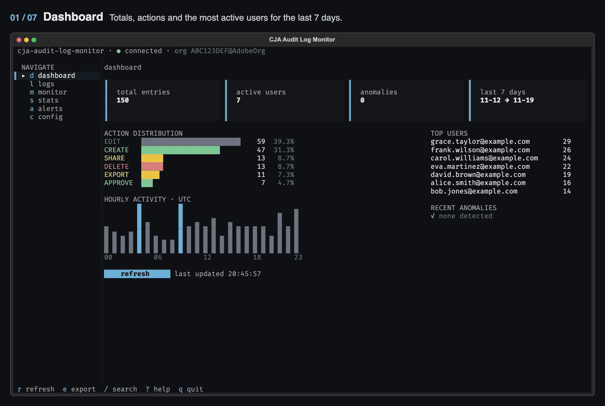

# CJA Audit Log Monitor

[](https://github.com/brian-a-au/cja-audit-log-monitor/actions/workflows/ci.yml)
[](https://github.com/brian-a-au/cja-audit-log-monitor/actions/workflows/release.yml)
[](https://pypi.org/project/cja-audit-log-monitor/)
[](https://www.python.org/downloads/)
[](https://github.com/brian-a-au/cja-audit-log-monitor/tree/main/tests)
[](https://github.com/astral-sh/ruff)
[](https://github.com/astral-sh/uv)
[](https://textual.textualize.io/)
[](https://github.com/brian-a-au/cja-audit-log-monitor/blob/main/LICENSE)

[](https://github.com/brian-a-au/cja-audit-log-monitor/blob/main/docs/showcase.png)

A 28-second loop of the real app, made from synthetic data. Click the animation for a still image.

A terminal app for monitoring and analyzing Adobe Customer Journey Analytics (CJA) audit logs. You can browse and filter the logs, watch new events arrive, see charts of activity, and get alerts about suspicious patterns. A CLI is included for scripts and automation.

> This is an unofficial, community project. It is not affiliated with, endorsed by, or supported by Adobe. Adobe and Customer Journey Analytics are trademarks of Adobe Inc.

## Features

- **Keyboard navigation.** Each view has a single key, and `?` shows them all.
- **Real-time monitor.** New audit events appear as they happen, at a polling interval you choose.
- **Filtering.** You can filter by user, action type, component type, and text in the description.
- **Charts.** You can see action counts, activity by hour, and activity by day.
- **Alerts and anomalies.** Rules detect bulk deletes, bulk exports and bulk shares. Separate anomaly checks find unusual activity between midnight and 5am. You can send alerts to Slack or to a webhook.
- **Export.** You can save filtered logs as JSON, CSV, or TSV, either the page you see or every matching entry.

## Install

You need Python 3.11 or newer. Install the tool with [uv](https://docs.astral.sh/uv/) or [pipx](https://pipx.pypa.io/):

```bash
uv tool install cja-audit-log-monitor
# or
pipx install cja-audit-log-monitor
```

## Set up credentials

The tool uses an Adobe OAuth Server-to-Server credential from the [Adobe Developer Console](https://developer.adobe.com/console). See [docs/configuration.md](https://github.com/brian-a-au/cja-audit-log-monitor/blob/main/docs/configuration.md) for the full steps.

Set these environment variables, or put them in a `.env` file in the folder where you run the tool:

```bash
ORG_ID=YOUR_ORG_ID@AdobeOrg
CLIENT_ID=your_client_id
SECRET=your_client_secret
```

Then check that the connection works:

```bash
cja-audit-log-monitor cli verify
```

## Run it

```bash
# Open the TUI
cja-audit-log-monitor

# The same, by name
cja-audit-log-monitor tui

# Or use the CLI, e.g. watch for anomalies and send them to Slack.
# Delivery is off by default. Set notify_on_anomalies: true to turn it on.
cja-audit-log-monitor cli anomalies --watch

# Print the version
cja-audit-log-monitor --version
```

Two options work with the TUI and with every CLI command. Put them before `cli` or `tui`:

- `-v` / `--verbose` turns on debug logging to stderr. It affects the CLI only. The TUI has no log file, and it shows logged warnings as toasts.
- `-c` / `--config PATH` reads a config file other than `~/.cja-audit-log-monitor/config.yaml`. You can also set the path with the `CJA_CONFIG_PATH` environment variable.

CLI commands write data to stdout and messages to stderr. Most of them accept `-F json`. See the [CLI reference](https://github.com/brian-a-au/cja-audit-log-monitor/blob/main/docs/cli.md) for every command and flag.

## Run from source

```bash
git clone https://github.com/brian-a-au/cja-audit-log-monitor
cd cja-audit-log-monitor
uv sync --all-extras
cp .env.example .env   # then add your credentials
uv run cja-audit-log-monitor
```

## The TUI

The TUI is built with [Textual](https://textual.textualize.io/). Each view has its own key, and you can switch views at any time. The layout fits terminals from 80x24 up to wide screens.

### [Dashboard](https://github.com/brian-a-au/cja-audit-log-monitor/blob/main/docs/screens/dashboard.md) (press `d`)

The dashboard sums up recent activity. It shows the total number of entries, the dates of the window, a chart of actions, the top users and recent anomalies. [Read more](https://github.com/brian-a-au/cja-audit-log-monitor/blob/main/docs/screens/dashboard.md)

### [Log Browser](https://github.com/brian-a-au/cja-audit-log-monitor/blob/main/docs/screens/log-browser.md) (press `l`)

The log browser shows audit entries in a table. You can filter them by user, action, component and description text, and page through the results. Press `Enter` on a row to see every field of the entry. [Read more](https://github.com/brian-a-au/cja-audit-log-monitor/blob/main/docs/screens/log-browser.md)


### [Real-Time Monitor](https://github.com/brian-a-au/cja-audit-log-monitor/blob/main/docs/screens/monitor.md) (press `m`)

The monitor shows new audit events as they arrive. You choose how often it checks, and it shows an alert when a rule fires. [Read more](https://github.com/brian-a-au/cja-audit-log-monitor/blob/main/docs/screens/monitor.md)


### [Statistics](https://github.com/brian-a-au/cja-audit-log-monitor/blob/main/docs/screens/statistics.md) (press `s`)

The statistics view shows charts of actions, activity by hour and by day, and a ranking of users, for the number of days you choose. [Read more](https://github.com/brian-a-au/cja-audit-log-monitor/blob/main/docs/screens/statistics.md)


### [Alerts](https://github.com/brian-a-au/cja-audit-log-monitor/blob/main/docs/screens/alerts.md) (press `a`)

The alerts view lets you turn rules on and off and test them against recent data. These changes last until you quit. [Read more](https://github.com/brian-a-au/cja-audit-log-monitor/blob/main/docs/screens/alerts.md)


### [Config](https://github.com/brian-a-au/cja-audit-log-monitor/blob/main/docs/screens/settings.md) (press `c`)

The config view shows the connection status and the settings in use. You can test the connection and load the settings again. [Read more](https://github.com/brian-a-au/cja-audit-log-monitor/blob/main/docs/screens/settings.md)


## Keyboard shortcuts

| Key | Action |
|-----|--------|
| `d` | Go to the dashboard |
| `l` | Go to the log browser |
| `m` | Go to the monitor |
| `s` | Go to statistics |
| `a` | Go to the alerts view |
| `c` | Go to the config view |
| `/` | Go to the search box |
| `Tab` | Move to the next control |
| `r` | Refresh the current view |
| `e` | Open the export dialog |
| `n` / `p` | Next or previous page (in the log browser). The footer does not list these keys, but they still work. |
| `Enter` | Show entry details (in the log browser) |
| `Space` | Start or stop the monitor (in the monitor) |
| `?` | Show the keyboard shortcuts |
| `Esc` | Close a dialog or the detail panel, or leave a filter box or the stats days box |
| `q` | Quit. This also works while the help overlay is open. |

## Documentation

Setup, scripting, and reference material live under [`docs/`](https://github.com/brian-a-au/cja-audit-log-monitor/blob/main/docs/):

| Topic | Page |
|---|---|
| Configure Adobe OAuth credentials and verify | [docs/configuration.md](https://github.com/brian-a-au/cja-audit-log-monitor/blob/main/docs/configuration.md) |
| OAuth errors, setup checklist, security notes | [docs/troubleshooting.md](https://github.com/brian-a-au/cja-audit-log-monitor/blob/main/docs/troubleshooting.md) |
| Full CLI command reference (`cja-audit-log-monitor cli ...`) | [docs/cli.md](https://github.com/brian-a-au/cja-audit-log-monitor/blob/main/docs/cli.md) |
| How to write and tune alert rules | [docs/alert-rules.md](https://github.com/brian-a-au/cja-audit-log-monitor/blob/main/docs/alert-rules.md) |
| Action types, component types, upstream API | [docs/reference.md](https://github.com/brian-a-au/cja-audit-log-monitor/blob/main/docs/reference.md) |
| Tests, lint, project layout | [docs/development.md](https://github.com/brian-a-au/cja-audit-log-monitor/blob/main/docs/development.md) |
| Per-screen TUI guides | [docs/screens/](https://github.com/brian-a-au/cja-audit-log-monitor/blob/main/docs/screens/) |

## Contributing

Bug reports and pull requests are welcome. See [CONTRIBUTING.md](https://github.com/brian-a-au/cja-audit-log-monitor/blob/main/CONTRIBUTING.md). Everyone who takes part follows the [code of conduct](https://github.com/brian-a-au/cja-audit-log-monitor/blob/main/CODE_OF_CONDUCT.md). To report a security problem, see [SECURITY.md](https://github.com/brian-a-au/cja-audit-log-monitor/blob/main/SECURITY.md).

## License

MIT. See [LICENSE](https://github.com/brian-a-au/cja-audit-log-monitor/blob/main/LICENSE).
