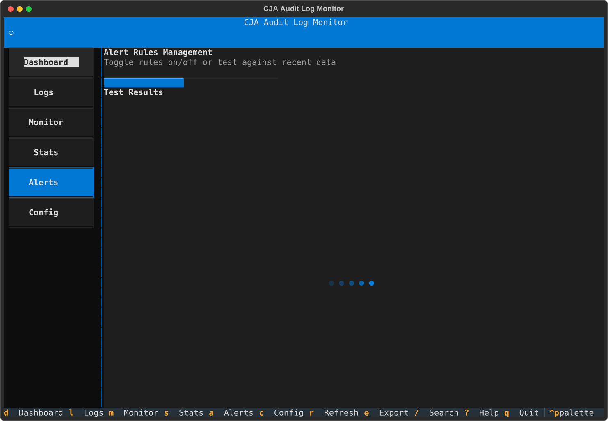

# Alert Rules

The alert rules view lets you turn rules on and off, see what each rule watches, and test the rules. The live monitor in the TUI uses these rules. Press `a` to open it.

## What you see

- **A title and a short help text.**
- **One card for each rule.** Each card has:
  - A checkbox that turns the rule on or off.
  - The rule's description.
  - One summary line with the threshold (`N events / M min`), the actions and the components the rule watches. It says `all actions` or `all components` when the rule watches all of them.
  - A border color that shows whether the rule is on or off.
- **Two buttons**, `test rules` and `reset rules`.
- **A results box** that fills in after a test. It gives the number of alerts that would have fired, or says `no alerts triggered`. If the test fails, the box shows the error.

A rule name can contain spaces and brackets. The view shows it as it is.

## What you can do

- **Turn a rule on or off** with its checkbox. A running monitor uses the change right away.
- **Test the rules** with `test rules`. The view reads up to 1,000 entries from the last 24 hours, runs every rule that is on, and shows what would have fired. The test uses a separate copy of the rules. It does not change the counts of a running monitor, and it does not send notifications.
- **Reset the rules** with `reset rules`. This undoes your checkbox changes. The rules are rebuilt from your config file, or from the built-in rules if the file has none.
- **Refresh** with `r`. The focus stays on the same rule.

## Changes last only until you quit

Turning rules on and off here does not change the config file. The tool keeps the change only while the app runs. When you quit and start again, the rules come from the config file. To make a change that lasts, edit the config file. See [Alert Rules](../alert-rules.md) for the format.

## When to use it

- **Test before you rely on a rule.** Run `test rules` on recent activity to see what the rules would have caught. Then change the thresholds in the config file if you need to.
- **Silence a noisy rule for a while.** Turn it off during a planned change, without editing the config file or restarting the TUI.
- **Check your thresholds.** If 24 hours of normal activity give `no alerts triggered`, your thresholds are not too strict.
- **Use the same rules everywhere.** The CLI commands `alerts test`, `monitor` and `tail` read the same rules from the config file. Your checkbox changes in the TUI do not reach the CLI.
- **Send alerts out.** When the config file has a `notifications:` block, each alert that fires in the monitor is also sent to Slack or your webhooks. See [Delivery channels](../alert-rules.md#delivery-channels).
