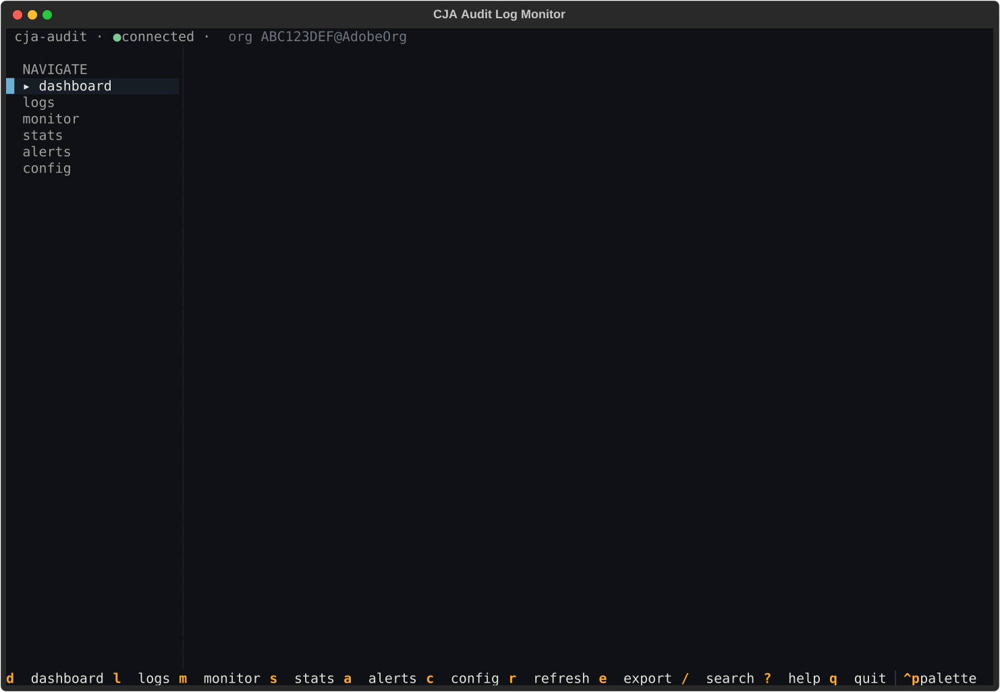

# Dashboard

The dashboard is the first view you see when the TUI opens. It sums up recent audit activity. Press `d` from any view to come back to it.

## What you see

- **Connection status** in the header, on every view. It reads `connecting`, `connected` with the Adobe org, or `disconnected` with the first line of the error. Any view that loses the connection sets it to `disconnected`. The next successful load sets it back to `connected`. If the config file has an error, the header also shows a short warning.
- **Stat cards** with the total number of entries in the window, the number of active users, the number of recent anomalies, and the dates of the window. The anomalies card uses the warning color when the number is not zero.
- **The window** is `default_days` from the config file, which is 7 days unless you change it. See [Configuration](../configuration.md#settings).
- **A sample note** under the cards when the window has more than 1,000 entries. The charts and lists then use the newest 1,000 entries. The total still counts every entry in the window.
- **Left column** with an action chart and an hourly activity chart. The action chart shows a bar, a count and a percent for each action, colored by how risky the action is. The hourly chart uses your local time zone.
- **Right column** with the top users and their action counts, and the recent anomalies.
- **Recent anomalies**, up to five, from the [anomaly checks](../alert-rules.md#anomaly-checks). The dashboard judges off-hours activity in your local time zone. The TUI only shows anomalies. It does not send them to Slack or webhooks. To send them, run `cja-audit-log-monitor cli anomalies` (see [CLI Reference, `anomalies`](../cli.md#anomalies)).
- **Last updated** time and a `refresh` button.

At 160 columns or wider, the dashboard fills the screen and the hourly chart grows to fill its column. Below 100 columns, the sidebar shows only the key letters.

## What you can do

- Press `r` or click `refresh` to load the window again.
- Check the connection. If the header shows `disconnected`, the dashboard shows the error and points you to the config view (`c`) or to `cja-audit-log-monitor cli verify`.
- See anomalies without writing any rules first.
- Press `l` for the log browser, `s` for statistics, `m` for the monitor, or `a` for the alerts view.

## When to use it

- **A daily check.** Open the TUI, look at the totals, the top users and the anomalies, and close it.
- **A first look during an incident.** You can see the total activity, who is active, and whether any anomaly showed up.
- **A connection test.** If the dashboard loads, your OAuth credential, scopes, product profiles and API access all work.
- **A quick load.** The charts use at most the newest 1,000 entries, which takes one API request. For more entries or a longer window, use the [Statistics](statistics.md) view.
