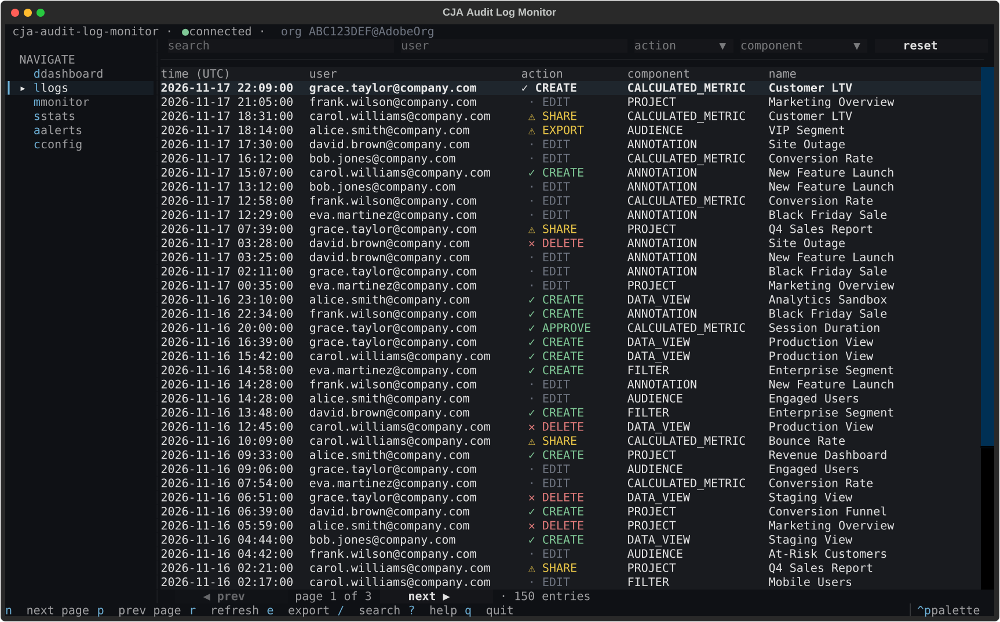

# Log Browser

The Log Browser is the workhorse for triage and forensic lookups — a paginated, filterable table of every audit entry the API returns. Press `l` to open it.

## What you see

- **Filter bar** at the top: free-text search, user (email), action type, and component type pickers. Filters apply server-side where supported and client-side for free-text.
- **Log table**: timestamp, action, component type, component name/ID, user email, and IP. Action cells are color-coded so DELETE/EXPORT stand out at a glance.
- **Detail side panel** (toggle with `Enter`): full raw payload for the highlighted row — every field the API returned, including descriptions and IDs that don't fit in the table.
- **Pagination controls**: `◀ prev` / `next ▶` buttons and a "Page X of Y / Total: N entries" counter.

## What you can do

- **Filter** by user, action, component, or free text. Filters compose — set all four to narrow aggressively.
- **Search-as-you-go**: change a filter and the table reloads from the API; the page resets to 1 automatically.
- **Page through results** with `n` (next), `p` (prev), or the buttons. The next/prev buttons disable when you hit either edge.
- **Inspect a single entry** with `Enter` — the side panel slides in next to the table. Move the cursor and the panel updates live; press `Esc` or `Enter` again to close.
- **Reset filters** in one click via the filter bar's reset action.
- **Export the current view** with `e` to JSON / CSV / TSV — exports honour the active filters.

## Use cases & benefits

- **Forensics**: "who deleted this Workspace project last Tuesday?" Filter by component name, action=DELETE, narrow by date — the answer is 3 keystrokes away.
- **User audit**: filter by `user@company.com` to get every action taken by a specific account, paginated.
- **Compliance evidence**: filter to the relevant scope, hit `e`, and you have a CSV ready to attach to a ticket or audit response.
- **Side-panel pattern**: unlike a full-screen modal, the detail panel keeps the table cursor visible, so you can scroll through entries one-by-one without losing your place.
- **Server-side pagination** means the table is responsive even when the underlying result set spans hundreds of thousands of entries.
