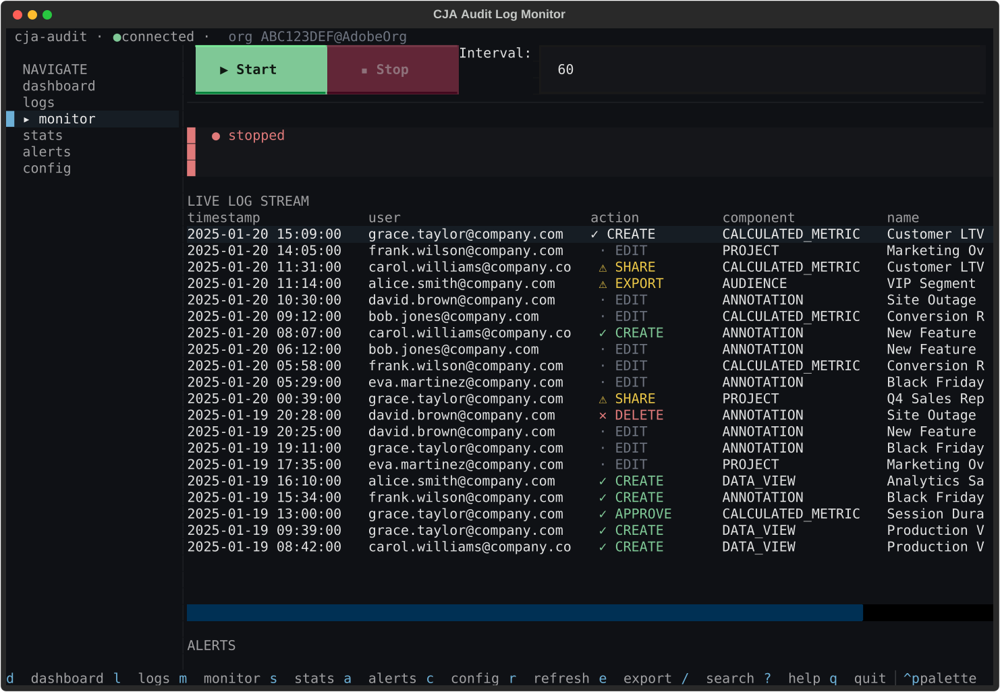

# Real-Time Monitor

The monitor asks the audit API for new events at a set interval. It adds each new event to a live table and checks it against your alert rules. Press `m` to open it.

## What you see

- **The controls**, which are the `▶ start` and `■ stop` buttons and an `interval` box in seconds.
- **The status row**, which shows `running`, `stopped` or an error. Its color and its left border change with the state. It also shows the time of the last check, the number of new events and the number of alerts. It updates after every poll.
- **The live log stream**, a table with the same colored action column as the log browser.
  - The newest event is at the bottom.
  - When the cursor is on the last row, the view follows new rows as they arrive. When you move the cursor up, the view stays where you put it.
  - The table keeps the newest 1,000 rows and drops older ones.
  - The table is cleared each time you start the monitor.
- **The alerts panel**, a short summary of the alerts that fired since you started.
- **Toasts** for alerts and warnings, e.g. "High event volume detected".
- **A delivery warning** if a send to Slack or a webhook fails. You see one warning for each channel. Later failures on that channel show no warning until a send works again. The log records every failure.

## How polling works

- The interval box starts at `monitor_interval` from the config file, which is 60 seconds unless you change it.
- The first poll after you press start reads the last 5 minutes. It shows up to 100 of those entries so you have some context. It does not alert on them or count them as new.
- Each later poll reads from 5 minutes before the last good poll up to now. The monitor skips entries it has already shown. This overlap catches events that the API indexed late.
- One poll reads at most 20 pages. If it reaches that limit, a toast warns you.
- After a good poll, the header shows `connected` again.
- When a poll fails, the status row shows the error. Only the first failure in a row shows a toast. The monitor keeps trying at each interval, so you can fix your settings and carry on. The CLI `monitor` command is different, because it stops on a login or permission error.

## What you can do

- **Start and stop** with the buttons or with `Space`. `Space` works even when the interval box has focus.
- **Change the interval.** Type a number of seconds and press `Enter`. The value must be 5 or more. If it is lower, the box is marked as invalid and the old value stays.
- **Watch alerts fire.** Each poll checks the new events against the alert rules that are on. The toast shows the rule name and the message, e.g. `bulk_delete: Multiple delete operations: 5 events in 60 minutes`. Rules with `per_user: true` count each account on its own. When the config file has a `notifications:` block, each alert is also sent to Slack or your webhooks. See [Delivery channels](../alert-rules.md#delivery-channels).
- **Poll now.** Press `r` while the monitor runs to poll at once. The interval timer does not change, and two polls never run at the same time.
- **Stop.** The poll in progress is dropped, so it cannot add rows after you stop. Starting again begins a new session with a new first poll.

## When to use it

- **During an incident.** Run the monitor with a short interval, e.g. 5 to 15 seconds, to see `DELETE` and `EXPORT` events as they happen.
- **During a planned change.** Watch the stream to check that the right components change and nothing else does.
- **While on call.** Turn on the rules you care about, e.g. bulk deletes, and keep the view open in your terminal.
- **No extra setup.** The monitor uses the same API and credentials as the rest of the tool.
