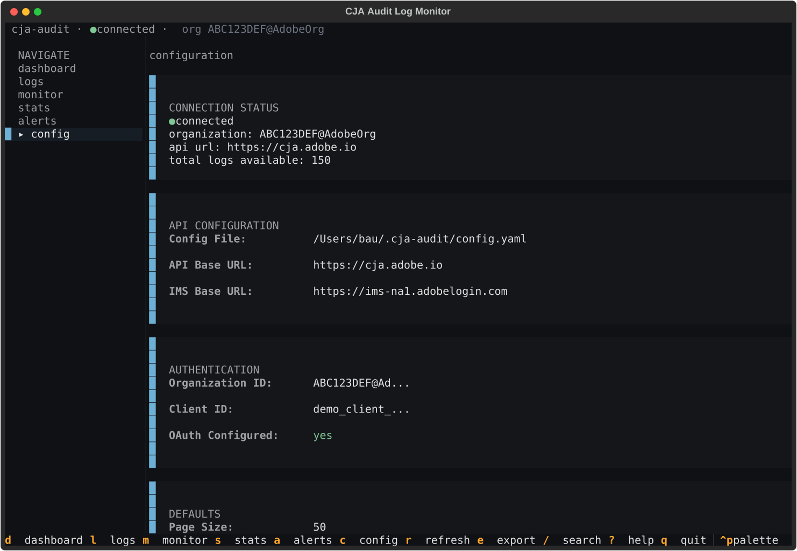

# Config

The config view shows the settings the app is using, and it can test the connection. Look here first when something does not work as you expect. Press `c` to open it.

## What you see

- **Two buttons** at the top, `verify connection` and `reload settings`. They come first, so they are on screen at every size.
- **Connection status.** When the login works, it shows a green dot, the org ID, the API URL and the number of logs available. When it fails, it shows a red dot and the error.
- **API configuration.** This is the path of the config file in use, the CJA API base URL and the IMS base URL. Your home folder is shown as `~`.
- **Authentication.** This is the full organization ID, the first 4 and last 4 characters of the client ID, and whether OAuth is set up. The view never shows the secret.
- **Defaults.** These are the page size, the number of days and the monitor interval.
  - The page size is the number of rows on each log browser page. Only the log browser uses it.
  - The number of days sets the window of the dashboard and the statistics view. It is also the CLI default for `--days`.
  - The monitor interval is the starting value of the monitor's interval box. It is also the default for `cli monitor --interval`.
- **Alert rules.** This is the number of rules in the config file. The alerts view (`a`) shows each rule.
- **Notifications.** This shows whether Slack is set up, how many webhooks are set up, and whether `notify_on_alerts` and `notify_on_anomalies` are on. The view never shows a URL or a header.

Below 160 columns, the sections are in one column, so long values such as the API URL stay on one line. At 160 columns or wider, the sections are in two columns.

## What you can do

- **Test the connection** with `verify connection`. It runs the same login and API call as `cja-audit-log-monitor cli verify`.
- **Load the settings again** with `reload settings` after you edit `.env` or the config file. The app reads the settings again and rebuilds the API client, the alert rules and the notification channels. Views you have already opened load again with the new page size, days and interval. A rule you turned off in the alerts view stays off. If the config file has an error, the app keeps the settings it has and shows a toast that says why. While the monitor runs, the app refuses to reload and tells you to stop the monitor first.
- **Check which credentials the app uses.** The org ID and the two ends of the client ID tell you which values it loaded. This helps when more than one place holds a credential. See [Where the credential comes from](../configuration.md#where-the-credential-comes-from).
- **Check the API URL.** A wrong API base URL is a common mistake. The URL must use https.

## When to use it

- **When a view shows no data.** Open the config view. A red status with an error message tells you more than an empty table.
- **After you set up credentials.** Click `verify connection` to check that your OAuth project works.
- **After you edit the config file.** Click `reload settings` instead of restarting the TUI.
- **When you share your screen.** The view hides the secret, the URLs and the headers, so you can show it to someone else.
