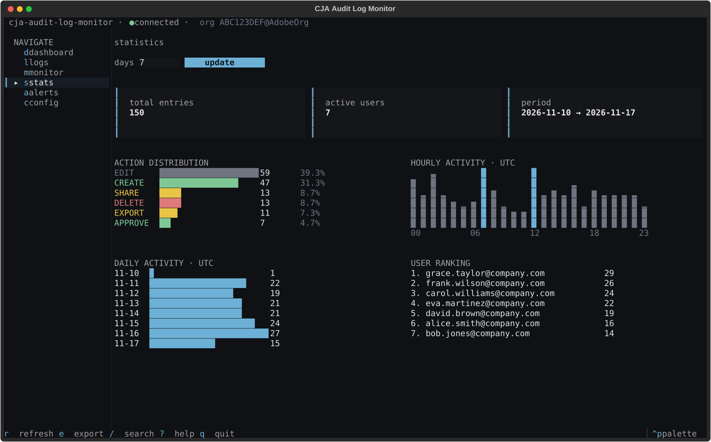

# Statistics

The Statistics screen runs deeper analytics over a configurable date window — up to 5,000 entries per query — and renders the results as charts and rankings. Press `s` to open it.

## What you see

- **Window control**: a `days` input and an `update` button. Default is 7 days. It stays visible even when the window has no activity, so you can widen it.
- **Stat cards**: total entries, active users, and the period actually covered by the result.
- **Action distribution** and **hourly activity** charts side by side. The busiest hour is highlighted.
- **Daily activity** (one bar per day, last 14 days in the window) and the **user ranking** (top 10 by action count) side by side.

## What you can do

- **Adjust the window** by typing a number and clicking `update` (or press `r` to refresh the current window).
- **Compare patterns over time** by stepping the window up (30 / 60 / 90 days) — the daily chart adapts automatically.
- **Identify peak hours** in the hourly chart to spot off-hours work or batch jobs.
- **Find power users and outliers** in the ranking — useful when the dashboard's top-5 isn't enough resolution.
- **Pivot to detail** — once a hot user, action, or hour stands out, jump to the Log Browser (`l`) and filter to it.

## Use cases & benefits

- **Capacity / usage reporting**: "how many edits did we do last quarter?" Set days to 90, take a screenshot of the summary panel.
- **Off-hours detection**: a tall bar at 02:00 in the hourly chart is a signal worth investigating, even if no alert rule fired.
- **User behaviour baselining**: the ranking gives you a sense of normal — which makes anomalies on the Dashboard easier to interpret.
- **Visual-first analytics**: charts are rendered in pure terminal characters, so the screen works over SSH without any GUI dependency.
- **Bounded by design**: a hard cap of 5,000 entries per query keeps the screen fast; widen the days to look further back rather than expecting unbounded results.
